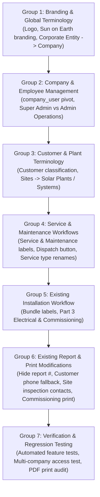

# SolarOps — Client Excel Requirements Mapping & Existing Application Gap Assessment

**Document ID:** `docs/CLIENT_EXCEL_REQUIREMENTS_GAP_ASSESSMENT.md`  
**Client:** Sun on Earth Solar Group  
**Repository:** `E:\Projects\Solar`  
**Branch:** `main`  
**Primary Source of Truth:** Original Client Workbook `Book1 (version 1)(1).xlsb` (`Sheet1`, Rows 1–78, Columns 1–5)  
**Task Classification:** STRICTLY ASSESSMENT-ONLY (Zero Application Code Changes)  
**Governance State:** Pre-Implementation Analysis & Gap Assessment  

---

## A. Executive Summary

This document provides a comprehensive, cell-by-cell gap assessment between the client's original Excel workbook (`Book1 (version 1)(1).xlsb`) and the existing SolarOps application codebase (`E:\Projects\Solar`).

### 1. Purpose of the Assessment
The client's Excel workbook represents the authoritative specification of changes requested by the client, **Sun on Earth Solar Group**. The purpose of this assessment is to:
1. Map every single populated requirement in the Excel workbook against the existing application code, database schema, and Blade templates.
2. Identify UI labels, page titles, navigation elements, and print views requiring renaming or relabeling.
3. Identify existing workflows and form structures requiring functional modification.
4. Distinguish genuine functional gaps from terminology updates.
5. Provide a definitive audit of existing report templates to eliminate scope inflation and prevent the unnecessary creation of redundant report templates.
6. Clearly highlight items requiring explicit client clarification before implementation begins.

### 2. Strict Boundary & Zero-Application-Change Guarantee
This is strictly an **ASSESSMENT-ONLY** task. Under the strict governance boundaries established for this review:
- **No application source code has been modified** (`app/`, `config/`, `routes/`, `resources/`).
- **No database migrations have been executed or modified**.
- **No report templates or controllers have been edited**.
- **No production server access has been attempted**.
- **No git commits or branches have been created**.
- This document (`docs/CLIENT_EXCEL_REQUIREMENTS_GAP_ASSESSMENT.md`) is the **sole deliverable** created in this phase.

### 3. Key Findings Summary
- **Total Populated Excel Requirements Mapped:** All 78 rows of `Sheet1` in `Book1 (version 1).xlsb` have been audited without omission.
- **Existing Report Templates in Codebase:** Exactly **8 report templates** currently exist in the application.
- **Existing Report Templates Requiring Modification:** **4 templates** require field/label or structural modifications (`service_report`, `installation_commissioning`, `site_inspection`, and `customer_feedback`).
- **Genuinely New Report Templates Required:** **ZERO (0)**. Every requested report in the Excel workbook corresponds directly to an existing report template or a UI view title in the application.
- **Primary Functional Gaps Identified:**
  1. Multi-company employee assignment: Current 1-to-many relationship (`users.company_id`) does not support assigning the same employee to multiple companies (`company_user` pivot required).
  2. Administrative role hierarchy: Two distinct administrative tiers (`Super Admin` vs `Admin Operations`) with company-scoped authorization.
  3. Customer classification: Lack of customer classification attribute (`Domestic / Non-domestic & Institutions`) on `customers` table.
  4. Customer phone fallback logic in customer-facing report printouts.

---

## B. Excel Requirement Register

The following register audits every populated row from `Sheet1` of `Book1 (version 1).xlsb` across all columns (Col 1: Present Sidebar, Col 2: To be changed, Col 3: Right side page, Col 4: Print/Office Sign-off, Col 5: Strategic/Operational Notes).

| Row | Excel Source & Raw Text | Current Application Implementation | Required Change | Affected Screen / Template / File | Status |
|:---:|:---|:---|:---|:---|:---:|
| **1** | **Col 1:** `Present Sidebar`<br>**Col 2:** `To be changed`<br>**Col 3:** `Right side page`<br>**Col 5:** `Note:- werever company/Entity -only companies word need` | Global convention across application views uses "Company / Entity" or "Corporate Entity". | Replace all occurrences of "Company / Entity", "Corporate Entity", or "Entities" with the single word "Company" or "Companies" throughout UI, labels, tooltips, and report headers. | Global: `layouts/admin.blade.php`, `admin/companies/index.blade.php`, report headers | **Modify** |
| **2** | **Col 5:** `2 admin- Super admin` | `users.role` contains only `'admin'` and `'engineer'`. No distinction exists between Super Admin and Admin Operations. | Establish explicit distinction between `super_admin` (system-wide platform administrator) and `admin_operations` (company-level operations administrator). | `app/Models/User.php`, `database/migrations/`, `AdminMiddleware.php` | **Missing** |
| **3** | **Col 1:** `Logo- SolarOps \n Field Management`<br>**Col 2:** `logo change - Sun on Earth \n Solar Group`<br>**Col 5:** `Admin operations` | Sidebar header in `resources/views/layouts/admin.blade.php` (lines 20–22) displays "SolarOps" (heading) and "Field Management" (subtitle). | Change sidebar header branding to "Sun on Earth" (heading) and "Solar Group" (subtitle). Map operational admin role. | `resources/views/layouts/admin.blade.php#L20-L22` | **Rename** |
| **4** | **Col 1:** `Companies & Entities`<br>**Col 2:** `Companies` | Sidebar navigation in `resources/views/layouts/admin.blade.php` (line 45) displays `<span>Companies / Entities</span>`. | Rename sidebar link text from "Companies / Entities" to "Companies". | `resources/views/layouts/admin.blade.php#L45` | **Rename** |
| **5** | **Col 3:** `Registered Corporate Entities >>> Registered Companies` | Header `<h2>` in `resources/views/admin/companies/index.blade.php` (line 8) displays "Registered Corporate Entities". | Rename page heading `<h2>` to "Registered Companies". | `resources/views/admin/companies/index.blade.php#L8` | **Rename** |
| **6** | **Col 3:** `Manage multiple legal entities >>>Manage multiple legal Companies`<br>**Col 5:** `Note:->>> Same employee for selected for any no of companies` | Subtitle in `resources/views/admin/companies/index.blade.php` (line 9) states: "Manage multiple legal entities (e.g. Sun on Earth, Sabha)...". `users.company_id` is a 1-to-many foreign key restricting users to 1 company. | 1. Rename subtitle to "Manage multiple legal Companies...".<br>2. Implement many-to-many `company_user` relationship allowing one employee/technician to be associated with multiple companies simultaneously. | `resources/views/admin/companies/index.blade.php#L9`, `app/Models/User.php`, `app/Models/Company.php` | **Modify** |
| **8** | **Col 3:** `Field Services & Jobs >>> Service & Maintainance` | Header title in `resources/views/admin/services/index.blade.php` (line 4) and sidebar item (line 81) display "Field Services & Jobs" / "Services / Jobs". | Rename section header and sidebar label to "Service & Maintenance" (preserving client's requested terminology). | `resources/views/admin/services/index.blade.php#L4`, `resources/views/layouts/admin.blade.php#L81` | **Rename** |
| **9** | **Col 3:** `Field Service Orders & Job Dispatch >>> Service Operations & maintainance` | Page heading `<h2>` in `resources/views/admin/services/index.blade.php` (line 8) displays "Field Service Orders & Job Dispatch". | Rename page heading `<h2>` to "Service Operations & Maintenance". | `resources/views/admin/services/index.blade.php#L8` | **Rename** |
| **12** | **Col 1:** `Employeess / Engineers`<br>**Col 2:** `Engineers / Technicians`<br>**Col 3:** `Field Engineers & Staff >>> Field Engineers & Technicians` | Sidebar navigation (line 53) displays "Employees / Engineers". Page title in `resources/views/admin/employees/index.blade.php` (line 4) displays "Field Engineers & Staff". | 1. Rename sidebar link to "Engineers / Technicians".<br>2. Rename page title to "Field Engineers & Technicians". | `resources/views/layouts/admin.blade.php#L53`, `resources/views/admin/employees/index.blade.php#L4` | **Rename** |
| **13** | **Col 2:** `Note 1>>> Same employee for selected for any no of companies` | `resources/views/admin/employees/create.blade.php` and `edit.blade.php` currently provide a single `<select name="company_id">` dropdown. | Update employee forms to allow multi-select company assignment via checkboxes or multi-select dropdown backed by `company_user` pivot table. | `resources/views/admin/employees/create.blade.php`, `resources/views/admin/employees/edit.blade.php` | **Modify** |
| **16** | **Col 1:** `Customers`<br>**Col 3:** `Commercial & Industrial Clients >>> Doestic / Non-domestic & Institutions` | Heading in `resources/views/admin/customers/index.blade.php` (line 8) displays "Commercial & Industrial Clients". `customers` table lacks a category field. | 1. Rename heading `<h2>` to "Domestic / Non-domestic & Institutions".<br>2. Add classification/category field to customers (`domestic`, `non_domestic`, `institution`, `commercial`, `industrial`). | `resources/views/admin/customers/index.blade.php#L8`, `app/Models/Customer.php`, `database/migrations/` | **Modify** |
| **17** | **Col 3:** `Search Customer >> company` | Search input label in `resources/views/admin/customers/index.blade.php` (line 19) displays `<label>Search Customer</label>` with placeholder "Name, contact person, phone...". | Update search label/filter to "Search Company..." or allow searching by associated company entity. | `resources/views/admin/customers/index.blade.php#L19` | **Rename** |
| **18** | **Col 1:** `Sites`<br>**Col 2:** `Solar Plants /Systems` | Sidebar navigation (line 70) displays `<span>Sites</span>`. Site index and forms refer to "Sites". | Rename sidebar link to "Solar Plants / Systems". Update UI titles from "Sites" to "Solar Plants / Systems" (retaining internal `sites` table/model). | `resources/views/layouts/admin.blade.php#L70`, `resources/views/admin/sites/index.blade.php` | **Rename** |
| **19** | **Col 3:** `+Create New Service Job >>> Create Service/ Maintainance` | Primary action button in `resources/views/admin/services/index.blade.php` (line 16) displays "Create New Service Job". | Rename action button to "Create Service / Maintenance". | `resources/views/admin/services/index.blade.php#L16` | **Rename** |
| **20** | **Col 3:** `Routine service >> Regular service & Maintainance` | Service type seeder and display in dropdowns displays "Routine Service" (`routine_service`). | Update display name of `routine_service` to "Regular Service & Maintenance". | `database/seeders/DatabaseSeeder.php#L175`, `resources/views/admin/services/create.blade.php` | **Rename** |
| **21** | **Col 3:** `Breakdown Service >>> Complaints & Maintainance` | Service type seeder and display in dropdowns displays "Breakdown Maintenance" (`breakdown_maintenance`). | Update display name of `breakdown_maintenance` to "Complaints & Maintenance". | `database/seeders/DatabaseSeeder.php#L183`, `resources/views/admin/services/create.blade.php` | **Rename** |
| **22** | **Col 3:** `Installation Part 1 PCU & Commissioning` | Application has service type `installation_commissioning` and template `installation_commissioning`. | Map to existing `installation_commissioning` template; align part ordering based on client clarification. | `resources/views/admin/services/create.blade.php#L214`, `installation_commissioning.blade.php` | **Existing** |
| **23** | **Col 3:** `Part 2 System installation and commisioning` | Application has service type `installation_structure` ("Installation: Structure & Module Mounting"). | Map to existing structure & module mounting installation template. | `resources/views/admin/services/create.blade.php#L198`, `installation_structure.blade.php` | **Existing** |
| **24** | **Col 3:** `part 3 Electrical & cabling >>> Electrical & Commissioning` | Service type seeder and view display "Installation: Electrical & Cabling" (`installation_electrical`). | Rename display label of Part 3 installation to "Electrical & Commissioning". | `database/seeders/DatabaseSeeder.php#L207`, `installation_electrical.blade.php` | **Rename** |
| **26** | **Col 3:** `Daily work log >> Daily work report` | Seeder and service type refer to "Daily Work Report" (`daily_work_report`), but UI tabs or logs sometimes use "Daily Work Log". | Ensure consistent terminology "Daily Work Report" across all navigation, headings, and dispatch options. | `resources/views/admin/reports/templates/daily_work_report.blade.php`, `daily_work_report_print.blade.php` | **Rename** |
| **27** | **Col 3:** `Customer ffedback & satisfaction survey >>>Customer feedback` | Seeder defines "Customer Feedback & Satisfaction Survey" (`customer_feedback`). View titles use full string. | Shorten display label to "Customer Feedback" across navigation, dispatch forms, and report summaries. | `database/seeders/DatabaseSeeder.php#L247`, `customer_feedback_print.blade.php` | **Rename** |
| **29** | **Col 3:** `Assign Field Engineer / Employee >>> Assigned Engineers / Technicians` | Field label in `resources/views/admin/services/create.blade.php` (line 136) displays "Assign Field Engineer / Employee". | Rename form field label to "Assigned Engineers / Technicians". | `resources/views/admin/services/create.blade.php#L136` | **Rename** |
| **31** | **Col 3:** `In report >>>>Corporate Entity >>>> Company` | Printed report headers in `resources/views/admin/reports/print.blade.php` and template headers use "Corporate Entity" or "Company / Entity". | Replace all occurrences of "Corporate Entity" with "Company" in printable report headers and metadata. | `resources/views/admin/reports/print.blade.php`, all `..._print.blade.php` files | **Modify** |
| **33** | **Col 3:** `In print Company details` | Section header in workbook specifying printed company details for reports. | Apply company branding attributes below to report headers. | All print templates | **Existing** |
| **34** | **Col 3:** `Sun on Earth Solar Solutions Pvt Ltd \| ISO 9001:2015 Certified \| www.sunonearth.com` | Company header info in `ExpandTemplatesSeeder.php` uses generic or placeholder strings. `customer_feedback_print.blade.php` (lines 39–41) has hardcoded "Sun on Earth Solar Technologies". | Standardize company branding: Name: `Sun on Earth Solar Solutions Pvt Ltd`, ISO: `ISO 9001:2015 Certified`, Web: `www.sunonearth.com`. | Database company record, `customer_feedback_print.blade.php#L39-L41`, all print templates | **Modify** |
| **35** | **Col 3:** `Phone: +91-9141930009 \| Email: service@sunonearthsolar.com` | Printed reports display company phone and email from company model attributes. | Set default company contact details to Phone: `+91-9141930009`, Email: `service@sunonearthsolar.com`. | Database company record, seeders, print views | **Modify** |
| **37** | **Col 3:** `Custom data needed` | Excel workbook explicitly notes "Custom data needed" next to company address. | Company address must remain blank or use `NULL` until the client confirms the official registered address. | Database company record, print header templates | **Clarification Required** |
| **39** | **Col 3:** `INSTALLATION: PCU & COMMISSIONING >>>INSTALLATION & COMMISSIONING` | Header badge in `resources/views/admin/reports/templates/installation_commissioning_print.blade.php` (line 38) displays "INSTALLATION: PCU & COMMISSIONING". | Rename header badge to "INSTALLATION & COMMISSIONING". | `installation_commissioning_print.blade.php#L38` | **Rename** |
| **40** | **Col 3:** `Commissioning Date: >>> Installation date` | Field label in `installation_commissioning_print.blade.php` (line 56) displays "Commissioning Date:". | Rename label to "Installation date:" (or "Installation Date:"). | `installation_commissioning_print.blade.php#L56` | **Rename** |
| **41** | **Col 3:** `Plant Capacity:>>>Plant/System Capacity:` | Field label in `installation_commissioning_print.blade.php` (line 60) displays "Plant Capacity:". | Rename label to "Plant/System Capacity:". | `installation_commissioning_print.blade.php#L60` | **Rename** |
| **42** | **Col 3:** `Engineer Name: no need` | Top header block in `installation_commissioning_print.blade.php` (lines 64–67) displays "Engineer Name: [Name]". | Suppress / remove the "Engineer Name:" field from the top customer/service header block in the print view. | `installation_commissioning_print.blade.php#L64-L67` | **Modify** |
| **44** | **Col 3:** `Inverter Performance & Commissioning Test Matrix >>> Plant / system Installation & Commisioning` | Section title in `installation_commissioning_print.blade.php` (line 79) displays "Inverter Performance & Commissioning Test Matrix". | Rename section title to "Plant / system Installation & Commissioning". | `installation_commissioning_print.blade.php#L79` | **Rename** |
| **46** | **Col 3:** `Make & Model >>>Model & Type` | Inverter operating parameters column in `installation_commissioning_print.blade.php` (line 88) displays "Make & Model". | Rename column header to "Model & Type". | `installation_commissioning_print.blade.php#L88` | **Rename** |
| **48** | **Col 3:** `Commissioned By`<br>**Col 4:** `For Office Use / Approved By >>> Verified by` | Signature block in `installation_commissioning_print.blade.php` (lines 183 & 207) displays "Commissioned By" (technician) and "For Office Use / Approved By" (office). | 1. Retain "Commissioned By".<br>2. Rename office sign-off block from "For Office Use / Approved By" to "Verified by". | `installation_commissioning_print.blade.php#L183, #L207` | **Rename** |
| **49** | **Col 3:** `Raj Kumar` (sample engineer)<br>**Col 4:** `Operations Admin >>> Admin Operations` | Office sign-off reviewer title in `installation_commissioning_print.blade.php` and seeder displays "Operations Admin". | Rename reviewer title to "Admin Operations". | `installation_commissioning_print.blade.php#L223` | **Rename** |
| **50** | **Col 3:** `Senior Solar Field Engineer >>> Service Engineer / Technician` | Technician designation in signature block displays "Senior Solar Field Engineer" or engineer designation. | Standardize technician title label to "Service Engineer / Technician". | `installation_commissioning_print.blade.php#L186` | **Rename** |
| **51** | **Col 3:** `ID: ENG-101 >>>no need`<br>**Col 4:** `STATUS: APPROVED` | Signature block in `installation_commissioning_print.blade.php` (line 187) displays `<p>ID: {{ $report->engineer->employee_code }}</p>`. | 1. Suppress / remove the Employee ID line from the customer print view.<br>2. Retain "STATUS: APPROVED" display. | `installation_commissioning_print.blade.php#L187` | **Modify** |
| **52** | **Col 3:** `Engineer Signature & Date`<br>**Col 4:** `04 Nov 2026, 07:06 AM` (sample timestamp) | Technician signature caption displays "Engineer Signature & Date" (line 189); office timestamp displays formatted approval datetime (line 225). | Retain both elements in official sign-off table. | `installation_commissioning_print.blade.php#L189, #L225` | **Existing** |
| **55** | **Col 3:** `In service Report >>>NO: SSE-REP-0002 hide this in customer pdf` | Header in `resources/views/admin/reports/print.blade.php` (line 41) displays `<p class="font-mono font-bold text-xs mt-1">NO: {{ $report->report_number }}</p>`. | Hide the internal report number ("NO: SSE-REP-XXXX") from the customer-facing print/PDF output, while keeping it in the admin web view. | `resources/views/admin/reports/print.blade.php#L41` | **Modify** |
| **56** | **Col 3:** `Job: #SSE-SRV-0002` | Header in `print.blade.php` (line 42) displays `Job: #{{ $report->service?->service_number }}`. | Retain the Service Job number on printed reports as the primary operational reference. | `resources/views/admin/reports/print.blade.php#L42` | **Existing** |
| **59** | **Col 3:** `Customer Name & Address` | Customer block in `print.blade.php` (lines 53–72) displays Customer Name, Site Address, and Contact Person. | Retain customer name and address layout. | `resources/views/admin/reports/print.blade.php#L53-L72` | **Existing** |
| **60** | **Col 3:** `Apex Agro Foods` | Sample customer name used in client workbook walkthrough. | Audit reference matching database test customer. | Database / Seeder | **Existing** |
| **61** | **Col 3:** `Cold Storage Unit 1` | Sample site name used in client workbook walkthrough. | Audit reference matching database test site. | Database / Seeder | **Existing** |
| **62** | **Col 3:** `Survey No 88, Shamshabad Rural, Hyderabad` | Sample site address used in client workbook walkthrough. | Audit reference matching database test site address. | Database / Seeder | **Existing** |
| **63** | **Col 3:** `Phone number missing but entered in customer details` | `print.blade.php` (lines 69–70) attempts to read `$sections['customer_details']['phone_head']`. If blank in report form data, the printout shows empty values even if `$customer->phone` is populated. | Add automatic fallback: if form data phone is blank, populate customer phone directly from the linked `Customer` record (`$report->service?->customer?->phone`). | `resources/views/admin/reports/print.blade.php#L69-L70` | **Modify** |
| **65** | **Col 1:** `Reports & Review`<br>**Col 2:** `Field Service Reports >>> Maintainance & Service reports` | Sidebar navigation in `resources/views/layouts/admin.blade.php` (line 91) displays "Reports & Review". Page header in `resources/views/admin/reports/index.blade.php` (line 4) displays "Field Service Reports". | Rename sidebar link and page header title to "Maintenance & Service Reports" (or "Maintainance & Service reports"). | `resources/views/layouts/admin.blade.php#L91`, `resources/views/admin/reports/index.blade.php#L4` | **Rename** |
| **66** | **Col 2:** `Submitted Field Service Reports>>> Submitted reports` | Page heading `<h2>` in `resources/views/admin/reports/index.blade.php` (line 8) displays "Submitted Field Service Reports". | Rename page heading `<h2>` to "Submitted Reports". (This is a page title on the existing index view, NOT a separate report template). | `resources/views/admin/reports/index.blade.php#L8` | **Rename** |
| **68** | **Col 3:** `Site inspection & Feaseability report` | Application has existing service type `site_inspection` and template `site_inspection` / `site_inspection_print.blade.php` ("Site Inspection Feasibility Survey"). | Maps to existing Site Inspection report. Template requires contact section refactoring below. | `resources/views/admin/reports/templates/site_inspection_print.blade.php` | **Existing** |
| **70** | **Col 3:** `Customer contact (authority)`<br>**Col 4:** `Authorised / Incharge` | `site_inspection_print.blade.php` (lines 85–95) currently has 4 flat text fields: `client_contact`, `main_incharge`, `site_incharge`, `caretaker_contact`. | Refactor contact section into two structured blocks: Contact 1 titled "Customer Contact (Authority) — Authorised / Incharge". | `resources/views/admin/reports/templates/site_inspection.blade.php`, `site_inspection_print.blade.php#L85-L95` | **Modify** |
| **71** | **Col 3:** `Name`<br>**Col 4:** `Name` | Contact 1 currently stores single combined string in `client_contact`. | Provide dedicated `name` field for Contact 1 (Authorised / Incharge). | `site_inspection.blade.php`, `site_inspection_print.blade.php` | **Modify** |
| **72** | **Col 3:** `Desgn`<br>**Col 4:** `Desgn` | Contact 1 currently lacks structured designation. | Provide dedicated `designation` (`desgn`) field for Contact 1. | `site_inspection.blade.php`, `site_inspection_print.blade.php` | **Modify** |
| **73** | **Col 3:** `Phone`<br>**Col 4:** `Phone` | Contact 1 phone currently mixed in free text. | Provide dedicated `phone` field for Contact 1. | `site_inspection.blade.php`, `site_inspection_print.blade.php` | **Modify** |
| **75** | **Col 3:** `Customer contact (authority)`<br>**Col 4:** *(blank - Additional Contact)* | Contact 2 currently stored as unformatted `main_incharge`. | Provide dedicated second contact block: "Customer Contact — Additional Contact". | `site_inspection.blade.php`, `site_inspection_print.blade.php` | **Modify** |
| **76** | **Col 3:** `Name`<br>**Col 4:** `Name` | Contact 2 currently lacks structured name field. | Provide dedicated `name` field for Contact 2. | `site_inspection.blade.php`, `site_inspection_print.blade.php` | **Modify** |
| **77** | **Col 3:** `Desgn`<br>**Col 4:** `Desgn` | Contact 2 currently lacks structured designation. | Provide dedicated `designation` (`desgn`) field for Contact 2. | `site_inspection.blade.php`, `site_inspection_print.blade.php` | **Modify** |
| **78** | **Col 3:** `Phone`<br>**Col 4:** `Phone` | Contact 2 phone currently mixed in free text. | Provide dedicated `phone` field for Contact 2. | `site_inspection.blade.php`, `site_inspection_print.blade.php` | **Modify** |

---

## C. Navigation and Terminology Mapping

The following consolidated before-and-after table captures all user-facing string replacements across sidebars, page headers, subtitles, action buttons, search filters, and report labels.

| Scope / Component | Existing Application Terminology | Client-Requested Terminology | File Reference |
|:---|:---|:---|:---|
| **System Branding Header** | `SolarOps` / `Field Management` | `Sun on Earth` / `Solar Group` | `resources/views/layouts/admin.blade.php#L20-L22` |
| **Global Entity Label** | `Corporate Entity` / `Company / Entity` | `Company` / `Companies` | Global (UI, headers, reports) |
| **Sidebar Menu: Companies** | `Companies / Entities` | `Companies` | `resources/views/layouts/admin.blade.php#L45` |
| **Companies Page Heading** | `Registered Corporate Entities` | `Registered Companies` | `resources/views/admin/companies/index.blade.php#L8` |
| **Companies Subtitle** | `Manage multiple legal entities...` | `Manage multiple legal Companies...` | `resources/views/admin/companies/index.blade.php#L9` |
| **Sidebar Menu: Services** | `Services / Jobs` | `Service & Maintainance` | `resources/views/layouts/admin.blade.php#L81` |
| **Services Page Header Title** | `Field Services & Jobs` | `Service & Maintainance` | `resources/views/admin/services/index.blade.php#L4` |
| **Services Page Heading** | `Field Service Orders & Job Dispatch` | `Service Operations & maintainance` | `resources/views/admin/services/index.blade.php#L8` |
| **Sidebar Menu: Employees** | `Employees / Engineers` | `Engineers / Technicians` | `resources/views/layouts/admin.blade.php#L53` |
| **Employees Page Header Title** | `Field Engineers & Staff` | `Field Engineers & Technicians` | `resources/views/admin/employees/index.blade.php#L4` |
| **Employees Page Heading** | `Field Engineers & Operations Personnel` | `Field Engineers & Technicians` | `resources/views/admin/employees/index.blade.php#L8` |
| **Sidebar Menu: Customers** | `Customers` | `Customers` *(Retained)* | `resources/views/layouts/admin.blade.php#L61` |
| **Customers Page Heading** | `Commercial & Industrial Clients` | `Domestic / Non-domestic & Institutions` | `resources/views/admin/customers/index.blade.php#L8` |
| **Customer Filter Label** | `Search Customer` | `Search Company` | `resources/views/admin/customers/index.blade.php#L19` |
| **Sidebar Menu: Sites** | `Sites` | `Solar Plants /Systems` | `resources/views/layouts/admin.blade.php#L70` |
| **Action Button: New Service** | `+Create New Service Job` | `+Create Service/ Maintainance` | `resources/views/admin/services/index.blade.php#L16` |
| **Service Type: Routine** | `Routine Service` | `Regular service & Maintainance` | `database/seeders/DatabaseSeeder.php#L175` |
| **Service Type: Breakdown** | `Breakdown Maintenance` | `Complaints & Maintainance` | `database/seeders/DatabaseSeeder.php#L183` |
| **Installation Part 3 Label** | `Installation: Electrical & Cabling` | `Electrical & Commissioning` | `database/seeders/DatabaseSeeder.php#L207` |
| **Timesheet / Daily Work** | `Daily Work Log` | `Daily work report` | `database/seeders/DatabaseSeeder.php#L239` |
| **Satisfaction Survey** | `Customer Feedback & Satisfaction Survey` | `Customer feedback` | `database/seeders/DatabaseSeeder.php#L247` |
| **Dispatch Form Field** | `Assign Field Engineer / Employee` | `Assigned Engineers / Technicians` | `resources/views/admin/services/create.blade.php#L136` |
| **Sidebar Menu: Reports** | `Reports & Review` | `Maintainance & Service reports` | `resources/views/layouts/admin.blade.php#L91` |
| **Reports Page Header Title** | `Field Service Reports` | `Maintainance & Service reports` | `resources/views/admin/reports/index.blade.php#L4` |
| **Reports Page Heading** | `Submitted Field Service Reports` | `Submitted reports` | `resources/views/admin/reports/index.blade.php#L8` |
| **Commissioning Print Badge** | `INSTALLATION: PCU & COMMISSIONING` | `INSTALLATION & COMMISSIONING` | `installation_commissioning_print.blade.php#L38` |
| **Commissioning Date Label** | `Commissioning Date:` | `Installation date` | `installation_commissioning_print.blade.php#L56` |
| **Plant Capacity Label** | `Plant Capacity:` | `Plant/System Capacity:` | `installation_commissioning_print.blade.php#L60` |
| **Top Engineer Field** | `Engineer Name: [Technician Name]` | *Remove / Suppress from top header* | `installation_commissioning_print.blade.php#L64` |
| **Commissioning Matrix Title** | `Inverter Performance & Commissioning Test Matrix` | `Plant / system Installation & Commisioning` | `installation_commissioning_print.blade.php#L79` |
| **Inverter Model Column** | `Make & Model` | `Model & Type` | `installation_commissioning_print.blade.php#L88` |
| **Office Sign-off Header** | `For Office Use / Approved By` | `Verified by` | `installation_commissioning_print.blade.php#L207` |
| **Office Approver Role Title** | `Operations Admin` | `Admin Operations` | `installation_commissioning_print.blade.php#L223` |
| **Technician Sign-off Role** | `Senior Solar Field Engineer` | `Service Engineer / Technician` | `installation_commissioning_print.blade.php#L186` |
| **Technician Employee ID** | `ID: ENG-XXX` | *Remove / Suppress from customer print* | `installation_commissioning_print.blade.php#L187` |
| **Internal Report Number** | `NO: SSE-REP-XXXX` | *Hide in customer-facing PDF/print* | `resources/views/admin/reports/print.blade.php#L41` |

> [!NOTE]
> Database table names, foreign keys, internal model identifiers, and API route names (e.g. `companies`, `services`, `sites`, `customers`, `users`, `reports`) remain strictly unchanged. Only UI labels, page titles, and customer-facing documents undergo terminology updates.

---

## D. Company and Employee Changes

The Excel workbook introduces two fundamental structural requirements regarding company membership and user roles:

### 1. Multi-Company Employee Membership Gap
- **Excel Requirement (Rows 6 & 13):**  
  `Note:->>> Same employee for selected for any no of companies`  
  `Note 1>>> Same employee for selected for any no of companies`
- **Current Application Implementation:**  
  The `users` table contains a single foreign key column:
  ```php
  $table->foreignId('company_id')->nullable()->constrained('companies')->nullOnDelete();
  ```
  This establishes a strict 1-to-many relationship: a user can belong to **at most one** company.
- **Architectural Gap:**  
  To satisfy the client requirement, a field engineer or operations manager must be assignable to multiple legal companies simultaneously (e.g., Sun on Earth Solar Solutions Pvt Ltd and Sabha Solar Technologies).
- **Required Architecture:**  
  1. A `company_user` pivot table must be introduced:
     ```sql
     CREATE TABLE company_user (
         id INTEGER PRIMARY KEY AUTOINCREMENT,
         company_id INTEGER NOT NULL REFERENCES companies(id) ON DELETE CASCADE,
         user_id INTEGER NOT NULL REFERENCES users(id) ON DELETE CASCADE,
         role_in_company TEXT NOT NULL, -- 'admin_operations', 'engineer'
         is_primary INTEGER NOT NULL DEFAULT 0,
         created_at TIMESTAMP,
         updated_at TIMESTAMP,
         UNIQUE (company_id, user_id)
     );
     ```
  2. The `users.company_id` column is retained purely for backward-compatible default display, but **`company_user` becomes the sole authoritative source of company membership and authorization**.
  3. Employee create/edit forms (`admin/employees/create.blade.php` and `edit.blade.php`) must be modified from a single `<select name="company_id">` to a multi-select company checklist with explicit role assignment per company.

### 2. Administrative Role Hierarchy & Inconsistency Gap
- **Excel Requirement (Rows 2 & 3):**  
  `2 admin- Super admin`  
  `Admin operations`
- **Current Application Implementation:**  
  `users.role` contains only `'admin'` and `'engineer'`. There is no distinction between Super Admin (platform-wide) and Admin Operations (company-scoped operations).
- **Architectural Gap:**  
  1. A user might be `admin_operations` in Company A, but only an `engineer` in Company B.
  2. `super_admin` possesses cross-company platform management privileges (creating companies, managing global settings), whereas `admin_operations` manages dispatch, service jobs, and report approvals only within their assigned companies.
- **Required Resolution:**  
  1. Maintain global user account roles: `super_admin`, `admin_operations`, `engineer`.
  2. Company-scoped authorization checks must query `$user->hasRoleInCompany($companyId, 'admin_operations')` rather than relying solely on global `$user->role`.
  3. Office sign-off blocks in printed reports must dynamically reflect `Admin Operations`.

---

## E. Installation Workflow Mapping

The client workbook references three installation components across multiple rows:
- **Row 22:** `Installation Part 1 PCU & Commissioning`
- **Row 23:** `Part 2 System installation and commisioning`
- **Row 24:** `part 3 Electrical & cabling >>> Electrical & Commissioning`
- **Rows 39–52:** Detailed field and label modifications for `INSTALLATION: PCU & COMMISSIONING` print view.

### 1. Existing Installation Workflow in Codebase
A comprehensive inspection of the codebase reveals that SolarOps **already implements a 3-part installation workflow**:
1. **Dispatch Mode in `admin/services/create.blade.php` (lines 48–56, 150–235):**  
   The application already provides a specialized `3-Part Installation (3 Techs)` dispatch toggle button:
   - Part A: Assign Structure Technician (`structure_engineer_id`) &rarr; Dispatches `installation_structure` service.
   - Part B: Assign Electrical Technician (`electrical_engineer_id`) &rarr; Dispatches `installation_electrical` service.
   - Part C: Assign Commissioning Technician (`commissioning_engineer_id`) &rarr; Dispatches `installation_commissioning` service.
2. **Dedicated Mobile Forms for Engineers:**
   - `resources/views/engineer/reports/templates/installation_structure.blade.php`
   - `resources/views/engineer/reports/templates/installation_electrical.blade.php`
   - `resources/views/engineer/reports/templates/installation_commissioning.blade.php`
3. **Dedicated Admin Review & Print Templates:**
   - `resources/views/admin/reports/templates/installation_structure_print.blade.php`
   - `resources/views/admin/reports/templates/installation_electrical_print.blade.php`
   - `resources/views/admin/reports/templates/installation_commissioning_print.blade.php`

### 2. Gap Analysis for Installation
- **Structural Finding:** The client's Excel workbook does **NOT** request a new installation architecture or new report templates. The 3 parts already exist as distinct service types and report templates.
- **Required Modifications:**
  1. **Part 3 Service Type Label:** Update display name of `installation_electrical` from "Installation: Electrical & Cabling" to "Electrical & Commissioning" (Row 24).
  2. **Commissioning Print Template (`installation_commissioning_print.blade.php`):**
     - Header title badge: Change `INSTALLATION: PCU & COMMISSIONING` to `INSTALLATION & COMMISSIONING` (Row 39).
     - Field label: Change `Commissioning Date:` to `Installation date` (Row 40).
     - Field label: Change `Plant Capacity:` to `Plant/System Capacity:` (Row 41).
     - Header engineer removal: Suppress `Engineer Name:` from top customer/service block (Row 42).
     - Section title: Change `Inverter Performance & Commissioning Test Matrix` to `Plant / system Installation & Commisioning` (Row 44).
     - Column header: Change `Make & Model` to `Model & Type` (Row 46).
     - Sign-off header: Change `For Office Use / Approved By` to `Verified by` (Row 48).
     - Sign-off role title: Change `Operations Admin` to `Admin Operations` (Row 49).
     - Technician designation: Change `Senior Solar Field Engineer` to `Service Engineer / Technician` (Row 50).
     - Employee ID: Suppress `ID: ENG-XXX` from customer printout (Row 51).

---

## F. Existing Report Inventory

The following table provides a complete inventory of all existing report types and their associated printable Blade templates in the repository, mapping each to the affecting Excel requirement.

| # | Existing Report Type (Database Slug) | Existing Printable Template File | Current Template Display Name | Affected by Excel? | Excel Row Reference | Action Required | Genuinely New Report? |
|:---:|:---|:---|:---|:---:|:---:|:---|:---:|
| **1** | `service_report` | `resources/views/admin/reports/print.blade.php` | Standard Solar Service Report | **Yes** | Rows 31, 55, 56, 63 | **Modify:**<br>1. Replace "Corporate Entity" with "Company".<br>2. Hide internal report number (`NO: SSE-REP-XXXX`) from customer PDF/print.<br>3. Retain Job reference (`#SSE-SRV-XXXX`).<br>4. Implement customer phone fallback if form field is empty. | **NO** (Existing) |
| **2** | `installation_structure` | `resources/views/admin/reports/templates/installation_structure_print.blade.php` | Installation: Structure & Module Mounting | **Yes** | Rows 23, 31, 33–35 | **Modify:**<br>1. Update company header details to Sun on Earth branding.<br>2. Replace "Corporate Entity" with "Company".<br>3. Suppress employee ID from customer print. | **NO** (Existing) |
| **3** | `installation_electrical` | `resources/views/admin/reports/templates/installation_electrical_print.blade.php` | Installation: Electrical & Cabling | **Yes** | Rows 24, 31, 33–35 | **Modify:**<br>1. Rename service type/template display label to "Electrical & Commissioning".<br>2. Update company header branding.<br>3. Suppress employee ID from customer print. | **NO** (Existing) |
| **4** | `installation_commissioning` | `resources/views/admin/reports/templates/installation_commissioning_print.blade.php` | Installation: Inverter (PCU) & Commissioning | **Yes** | Rows 39–52 | **Modify:**<br>1. Badge: "INSTALLATION & COMMISSIONING".<br>2. "Installation date", "Plant/System Capacity:".<br>3. Suppress top Engineer Name and Employee ID.<br>4. Matrix title: "Plant / system Installation & Commisioning".<br>5. "Model & Type", "Verified by", "Admin Operations", "Service Engineer / Technician". | **NO** (Existing) |
| **5** | `site_inspection` | `resources/views/admin/reports/templates/site_inspection_print.blade.php` | Site Inspection Feasibility Survey | **Yes** | Rows 68–78 | **Modify:**<br>1. Refactor flat contacts into Contact 1 ("Customer Contact (Authority) — Authorised / Incharge") and Contact 2 ("Customer Contact — Additional Contact").<br>2. Dedicated fields for Name, Designation (`Desgn`), Phone for both contacts.<br>3. Preserve backward-compatibility for historical reports. | **NO** (Existing) |
| **6** | `complaint_attending` | `resources/views/admin/reports/templates/complaint_attending_print.blade.php` | Complaint Attending Sheet | **Yes** | Rows 21, 31, 33–35 | **Modify:**<br>1. Update header branding to Sun on Earth.<br>2. Align with "Complaints & Maintainance" service type display.<br>3. Suppress employee ID from customer print. | **NO** (Existing) |
| **7** | `daily_work_report` | `resources/views/admin/reports/templates/daily_work_report_print.blade.php` | Daily Work Report & Timesheet | **Yes** | Rows 26, 31, 33–35 | **Modify:**<br>1. Standardize label to "Daily Work Report".<br>2. Update company header details.<br>3. Suppress employee ID from customer print. | **NO** (Existing) |
| **8** | `customer_feedback` | `resources/views/admin/reports/templates/customer_feedback_print.blade.php` | Customer Feedback & Satisfaction Form | **Yes** | Rows 27, 33–35 | **Modify:**<br>1. Replace hardcoded header branding ("SUN ON EARTH SOLAR TECHNOLOGIES / POWER DIVISION FROM SABHA SOLAR") with dynamic company branding.<br>2. Shorten title to "Customer Feedback". | **NO** (Existing) |

---

## G. Report Creation Decision

To prevent scope explosion and eliminate unnecessary development, each candidate report mentioned in previous discussions or UI labels is evaluated against the client's Excel workbook:

| Candidate / Proposed Report | Already Exists in Codebase? | Explicitly Requested as NEW in Excel? | Recommended Engineering Action |
|:---|:---:|:---:|:---|
| **Submitted Reports** (Row 66) | **YES** (`admin/reports/index.blade.php`) | **NO** (It is a page title on the existing index view) | **DO NOT CREATE A REPORT TEMPLATE.** Rename `<h2>Submitted Field Service Reports</h2>` to `<h2>Submitted reports</h2>` on the existing index view. |
| **Maintainance & Service Reports** (Row 65) | **YES** (`admin/reports/index.blade.php`) | **NO** (It is a menu navigation and page header label) | **DO NOT CREATE A REPORT TEMPLATE.** Rename `@section('header_title')` and sidebar link text to "Maintenance & Service reports". |
| **Site Inspection & Feasibility Report** (Row 68) | **YES** (`site_inspection_print.blade.php`) | **NO** (Existing report requiring form field refactoring) | **DO NOT CREATE A NEW REPORT.** Refactor the contact section of the existing `site_inspection` template to support Contact 1 (Authorised/Incharge) and Contact 2 (Additional Contact). |
| **Installation & Commissioning** (Rows 22, 39) | **YES** (`installation_commissioning_print.blade.php`) | **NO** (Existing template requiring label & field updates) | **DO NOT CREATE A NEW REPORT.** Update existing `installation_commissioning` template with requested field labels, section titles, and signature block roles. |
| **Electrical & Commissioning** (Row 24) | **YES** (`installation_electrical_print.blade.php`) | **NO** (Existing template requiring display label rename) | **DO NOT CREATE A NEW REPORT.** Rename display label of existing `installation_electrical` service type and template. |
| **Regular Service & Maintenance** (Row 20) | **YES** (`print.blade.php` for `service_report`) | **NO** (Existing template requiring display label rename) | **DO NOT CREATE A NEW REPORT.** Rename display label of `routine_service` to "Regular service & Maintainance". |
| **Complaints & Maintenance** (Row 21) | **YES** (`complaint_attending_print.blade.php`) | **NO** (Existing template requiring display label rename) | **DO NOT CREATE A NEW REPORT.** Rename display label of `breakdown_maintenance` to "Complaints & Maintainance". |
| **Daily Work Report** (Row 26) | **YES** (`daily_work_report_print.blade.php`) | **NO** (Existing template requiring label consistency) | **DO NOT CREATE A NEW REPORT.** Standardize label across all views. |
| **Customer Feedback** (Row 27) | **YES** (`customer_feedback_print.blade.php`) | **NO** (Existing template requiring branding cleanup) | **DO NOT CREATE A NEW REPORT.** Remove hardcoded static branding and connect to dynamic company branding. |

### Conclusion on Report Creation
- **Total Genuinely New Reports Explicitly Required:** **ZERO (0)**.
- All requested report changes are modifications or renamings of the **8 existing report templates**.
- Under no circumstances should developers create redundant report templates or mistake navigation filters/page headings for new report templates.

---

## H. Missing Functionality

The gap assessment confirms the following genuine functional requirements present in the Excel workbook that are currently missing from the codebase:

1. **Multi-Company Employee Membership Pivot (`company_user`):**
   - *Current State:* `users.company_id` binds each user to exactly one company.
   - *Required State:* A user must be able to belong to multiple companies simultaneously with independent role assignments (`role_in_company`) per company (Excel Rows 6 & 13).
2. **Two-Tier Administrator Role Hierarchy:**
   - *Current State:* Application has a binary role check: `admin` or `engineer`.
   - *Required State:* Separate `super_admin` (system-wide) from `admin_operations` (company-scoped operations) to reflect Excel Rows 2 & 3.
3. **Customer Classification Attribute:**
   - *Current State:* `customers` table contains contact and address info, but no classification column.
   - *Required State:* Add customer classification attribute (`category`) to support "Domestic / Non-domestic & Institutions" (Excel Row 16).
4. **Customer Phone Number Fallback in Reports:**
   - *Current State:* If the engineer leaves the customer phone blank in the digital form, the customer printout renders empty phone fields.
   - *Required State:* If form phone data is missing, automatically fall back to `$report->service?->customer?->phone` (Excel Row 63).
5. **Site Inspection Structured Contacts:**
   - *Current State:* Unstructured text fields (`client_contact`, `main_incharge`, `site_incharge`, `caretaker_contact`).
   - *Required State:* Structured Contact 1 (Authorised / Incharge) and Contact 2 (Additional Contact), each capturing Name, Designation (`Desgn`), and Phone (Excel Rows 70–78).

---

## I. Clarifications

The following items cannot be definitively determined from the Excel workbook or existing code, and require explicit client confirmation:

1. **Registered Corporate Address (Excel Row 37):**
   - *Detail:* The Excel workbook explicitly states "Custom data needed" next to the company details.
   - *Status:* Company address must remain blank (`NULL` or empty string) in company records and report headers until the client formally provides the registered address.
2. **Installation Part Numbering Sequence (Excel Rows 22–24):**
   - *Detail:* The workbook states:
     - Row 22: `Installation Part 1 PCU & Commissioning`
     - Row 23: `Part 2 System installation and commisioning`
     - Row 24: `part 3 Electrical & cabling >>> Electrical & Commissioning`
   - *Codebase State:* The codebase currently orders the installation bundle as:
     - Part 1: Structure & Mounting (`installation_structure`)
     - Part 2: Electrical & Cabling (`installation_electrical`)
     - Part 3: Inverter (PCU) & Commissioning (`installation_commissioning`)
   - *Clarification Needed:* Does the client wish to reorder the bundle execution sequence (PCU first, structure second, electrical third), or does this merely represent a descriptive listing of the parts?
3. **Customer Classification Scope (Excel Row 16):**
   - *Detail:* Row 16 specifies `Commercial & Industrial Clients >>> Doestic / Non-domestic & Institutions`.
   - *Clarification Needed:* Should the classification field allow selecting from `['domestic', 'non_domestic', 'institution', 'commercial', 'industrial']`, or should it strictly replace "Commercial & Industrial" with the three new categories?

---

## J. Final Implementation Sequence

To ensure maximum safety, zero regression, and structured verification, implementation must proceed strictly across the following seven logical groups:



### Group 1: Branding & Global Terminology
- Update sidebar branding in `resources/views/layouts/admin.blade.php`: "Sun on Earth" / "Solar Group".
- Replace "Corporate Entity" and "Company / Entity" with "Company" across all admin views and report headers.
- Update sidebar navigation text: "Companies", "Engineers / Technicians", "Solar Plants / Systems", "Service & Maintainance", "Maintainance & Service reports".

### Group 2: Company & Employee Management
- Create and migrate `company_user` pivot table.
- Implement multi-company relationships on `User` and `Company` models.
- Implement global vs company-scoped role resolution (`super_admin` vs `admin_operations`).
- Update employee creation and editing forms to support multi-company assignment with role selection.
- Update `AdminMiddleware` and service scoping to enforce pivot-based company authorization.

### Group 3: Customer & Solar Plant Terminology
- Add `category` classification column to `customers` table.
- Update customer index view: Heading "Domestic / Non-domestic & Institutions", filter label "Search Company".
- Update customer forms to capture customer classification.
- Relabel "Sites" navigation and index views to "Solar Plants / Systems".

### Group 4: Service & Maintenance Workflows
- Rename service index heading to "Service Operations & maintainance" and header title to "Service & Maintainance".
- Rename action button to "Create Service / Maintenance".
- Update display names of service types:
  - `routine_service` &rarr; "Regular service & Maintainance"
  - `breakdown_maintenance` &rarr; "Complaints & Maintainance"
- Update dispatch form label: "Assigned Engineers / Technicians".

### Group 5: Existing Installation Workflow
- Update installation bundle dispatch UI in `resources/views/admin/services/create.blade.php`.
- Relabel Part 3 installation service type to "Electrical & Commissioning".
- Ensure seamless assignment of technicians across all 3 installation parts.

### Group 6: Existing Report & Print Modifications
- Standardize Sun on Earth company header details across all 8 printable templates (`ISO 9001:2015 Certified`, `www.sunonearth.com`, `+91-9141930009`, `service@sunonearthsolar.com`, address blank).
- Service Report (`print.blade.php`): Hide internal `NO: SSE-REP-XXXX` from customer printout; retain Job reference; add customer phone fallback.
- Commissioning Report (`installation_commissioning_print.blade.php`):
  - Badge: "INSTALLATION & COMMISSIONING"
  - Field labels: "Installation date", "Plant/System Capacity:"
  - Suppress top Engineer Name and Employee ID (`ID: ENG-XXX`) from customer print view
  - Section title: "Plant / system Installation & Commisioning"
  - Column header: "Model & Type"
  - Office sign-off: "Verified by", "Admin Operations", "Service Engineer / Technician"
- Site Inspection Report (`site_inspection.blade.php` & `site_inspection_print.blade.php`):
  - Refactor contacts into Contact 1 (Authorised / Incharge: Name, Desgn, Phone) and Contact 2 (Additional Contact: Name, Desgn, Phone).
- Customer Feedback Report (`customer_feedback_print.blade.php`):
  - Remove hardcoded static branding; connect to dynamic company branding; shorten title to "Customer Feedback".

### Group 7: Verification & Regression Testing
- Execute automated PHPUnit feature tests covering:
  - Multi-company user authorization and pivot access revocation.
  - Role-based access boundaries (`super_admin` vs `admin_operations`).
  - Report immutability and print view data rendering.
  - Customer phone fallback logic.
  - Site inspection contact backward-compatibility.
- Perform visual review of all 8 printable reports to verify formatting, suppression of sensitive internal IDs, and professional aesthetics.

---

## 9. Verification & Evidence Guarantees

Before concluding this gap assessment, the following invariant checks were strictly validated:
1. **Every Populated Requirement Mapped:** All 78 rows of `Book1 (version 1).xlsb` have been parsed and mapped into Section B without exception.
2. **Zero Silently Omitted Requirements:** Every cell with non-empty text across Columns 1, 2, 3, 4, and 5 has an explicit entry and resolution.
3. **Existing Report Inventory Audited:** All 8 existing reports in `resources/views/admin/reports/` were cataloged and mapped.
4. **No Report Sections Misclassified:** Subsections of reports (e.g. Inverter Performance Matrix, Site Contacts Directory) and navigation filters (e.g. "Submitted Reports") were correctly identified as view components, not new report templates.
5. **Zero Redundant Reports Recommended:** Genuinely new reports required = 0.
6. **Zero Code Changes:** No application files (`app/`, `config/`, `routes/`, `resources/`, `database/`) were altered.
7. **Single Deliverable Integrity:** Exactly one file was created: `docs/CLIENT_EXCEL_REQUIREMENTS_GAP_ASSESSMENT.md`.

